# Mr. Furr

  

I am Kidus Yitayal (GitHub: mrfurr) - a focused offensive security practitioner, web application pentester, and bug bounty hunter. I build practical security tools, research vulnerabilities, and contribute to open-source projects that improve both offensive and defensive posture.

  
  
  
  

## Quick Highlights

-  Current work: Team project LucyBounty (collaboration with INSA Cyber Group)
-  Personal projects: PhishEye Ethiopia (phishing detection app) and long-term research into Quantum Cloud Firewall concepts
-  Focus areas: web app pentesting, vulnerability research, bug bounty programs, and security automation
-  Currently building: automation, PoCs, phishing detection tooling, and repeatable security workflows

## Core Skills

- Languages: Python · Bash · JavaScript · HTML/CSS · C (basics) · PHP
- Platforms / OS: Kali Linux · Ubuntu · Arch Linux · Windows
- Security tools: Burp Suite · Wireshark · Nmap · Metasploit · Sliver · Postman · Docker · Git
- Practices: Responsible disclosure · Reproducible PoC · Secure coding reviews · Automation & tooling

## Highlighted Projects

### 🔸 LucyBounty (Team)
A full-featured bug-bounty and vulnerability lifecycle platform. Responsibilities: backend integration, automated reporting templates, and vulnerability triage workflows. (Repo: LucyBounty)

### 🔸 PhishEye Ethiopia (Solo)
Phishing detection and reporting app targeted at local threat models combines heuristic checks, blocklists, and user reporting to reduce phishing impact.

### 🔸 Quantum Cloud Firewall (Research / Roadmap)
Conceptual R&D exploring quantum-inspired anomaly detection for cloud traffic. Active research and prototyping planned.

## What I build

- Automated scanners and PoCs for web vulnerabilities (XSS, SSRF, RCE, auth bypasses)
- Detection tooling for phishing and suspicious domains
- Reproducible demos and Dockerized testbeds for secure testing
- Integrations that make bug reporting and triage repeatable and fast

## Professional Practices

- Clean, atomic commits with meaningful messages
- Well-documented PRs and issue templates for contributors
- Dockerized demos for easy verification and testing
- Ethical, responsible disclosure and coordination with affected parties

## 📈 GitHub Visuals

  

  

## 📫 Connect

-  Email: kidusyitayal@gmail.com
-  Telegram: @OX7b_furr -> https://t.me/OX7b_furr
-  Instagram: @0x7b_furr -> https://instagram.com/0x7b_furr

## 🤝 Collaboration

Interested in collaborating? Open an issue, start a PR, or ping me on Telegram. I welcome team projects, research partners, and bug bounty collaborators.

If you find my work useful - star the repo and follow for updates on LucyBounty and PhishEye.

 Kidus (mrfurr)
